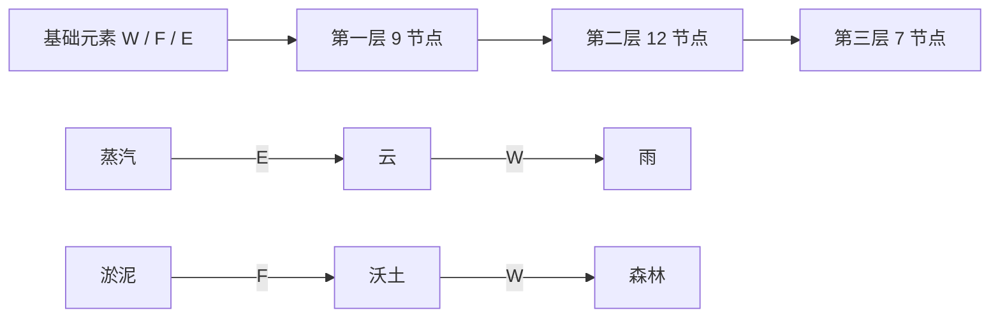

# 《三生炉 / Trinity Forge》开发 Plan v1.0

> 依据：同目录《游戏设计v1.0.md》，文档内版本为 v0.2（比赛 Demo 版）。
> 制定日期：2026-11-06。适用范围：1 人开发、移动端竖屏小游戏、比赛演示 Demo。
> 交付形态：已确定为移动端竖屏 H5 小游戏，通过手机浏览器访问；交付静态构建产物与部署说明，以手机触控体验为交互与验收基准。
> 计划制定时仓库只有设计文档。设计正文止于 3.4 标题；目录中的美术、技术方案、演示、风险和里程碑尚未展开。
> 本计划用于后续实施，不代表游戏规则已经定稿；新增规则均列为“原型默认”，先用于建立可验证的闭环。
> 实施进度（2026-11-06）：已实现可玩 H5、28 配方、教学、图鉴、局中恢复和静态构建；已增加炉火/水雾/摇晃的合成过程与每次合成的结果确认。65 项规则测试及 14 项生产构建浏览器测试通过。7 个第三层节点可达，保存了 10 个种子及 7 条目标通关路线。真机、真人试玩和外部托管验收待完成，详见 ../docs/playtest.md。

## 1. 交付目标与范围

交付一个面向手机竖屏、以点按为主的完整 H5 小游戏 Demo，通过移动浏览器访问：玩家完成 3 回合教学后，可以进行 12 回合正式游戏，通过顺序合成、环境调节和生态区产物管理，争取解锁至少 8 个不同图鉴节点。桌面端以居中的竖屏容器兼容演示。

### 必做（P0）

- 28 个合成节点：第一层 9 个、第二层 12 个、第三层 7 个，名称、配方、表内消耗和基础分完整录入。
- 基础元素手牌、按序投料、确认合成、调息、回合结算。
- 炉温、湿度、养分三槽，以及限制、失衡和随机摧毁产物。
- 生态区产物实例、催化时的取用与消耗、养分回补。
- 3 回合教学、12 回合正式关、胜负结算、重新开始。
- 图鉴、已发现配方、未发现节点提示、第三层首次解锁反馈。
- 本地历史图鉴、最佳成绩及局中恢复存储；可复现的随机种子。
- 手机竖屏单页界面、触控点按、安全区适配、清晰的资源与操作反馈、可发布的静态构建。
- 手机后台切换恢复、页面刷新后继续游戏、音频暂停与恢复。

### 优先完善（P1）

- 投料顺序调整、资源变化预览、最近一回合事件记录。
- 合成树连线视图、轻量动效、音效与静音开关。
- 带固定种子的演示入口、玩法说明与演示录像素材。

### 本轮不排入

挑战关、稀有资源转化版反噬、隐藏节点、账号与云存档、排行榜、桌面专属布局、复杂粒子系统、服务端、原生小游戏包与平台 SDK 接入。稳定性优先于这些扩展。

## 2. 开工前统一的规则

以下问题直接影响状态模型、交互和可通关性。D1 将它们固化为规则说明；在没有额外设计输入时，按下表的原型默认实施，后续通过试玩调整数值。

| 问题 | 设计中的缺口或冲突 | 原型默认 |
|---|---|---|
| 每回合投几张 | 核心循环写 1–2 张，配方 #7–9 需要 3 张 | 炉内最多 3 个输入；每回合最多提交一次合成；确认前可撤回，回合间不保留炉内输入 |
| 如何取用产物 | 手牌描述只有水火土，高层配方需要已有产物 | 基础元素来自手牌，产物从生态区按实例选取；两者进入同一有序输入栏 |
| 产物是否消耗 | 未说明升级与生态回补能否同时享受 | 合成成功消耗选中的产物实例，加入新实例；图鉴发现记录永久保留；同名实例可重复持有 |
| 二元与催化冲突 | W/F/E 任意顺序都可得温泉，同时蒸汽→E 得云 | 只对本次确认的完整输入匹配；[W,F,E] 得温泉，[蒸汽实例,E] 得云；不自动折叠输入前缀 |
| “第三种元素”含义 | 部分催化配方再次使用已有基础元素 | 以 28 条配方为准；催化剂不要求是前序未出现的元素 |
| 是否能反转严格配方 | 正文要求反序失败，但需要允许玩家尝试 | 允许基础元素、产物任意排序；严格匹配失败时仅扣 1 养分，保留材料，结束本回合 |
| 基础合成成本 | 正文称每次合成耗养分，部分配方表只扣炉温/湿度 | 每次合成尝试有 1 点养分基础成本；成功另扣配方表内消耗；UI 分别展示基础成本与配方成本 |
| 手牌如何获得 | 未给出手牌上限、补牌与弃牌规则 | 每回合刷新 6 张：固定 W/F/E 各 1 张，另 3 张用种子随机抽取；未用手牌不跨回合保留 |
| 如何“回资源” | 策略描述有回资源，但没有对应动作 | 增加“调息”：不合成，养分 +2，炉温与湿度各向中值靠近 1，消耗一个回合 |
| 湿度过高失败率 | 未给概率，也未给失败材料处理 | 湿度 ≥8 时有效配方有 25% 失败率；按投入基础元素后的湿度判断；失败只扣基础养分，保留材料 |
| 湿度过低限制 | 未定义“水系产物” | 以配方数据的 water 属性标记；湿度为 0 时禁止相应配方；逐条审定标签，不从名称猜测 |
| 极值与全盘失衡 | 未定义范围、同时触发和满养分是否危险 | 三槽范围 0–10；炉温/湿度的 0 和 10、养分的 0 为危险值；满养分安全；三槽同时危险则立即失败 |
| 重复失衡 | 未说明持续极值是否连续惩罚 | 每个回合结束重新判断；只要仍有危险槽，每回合最多随机摧毁一个实例；生态区为空时记录事件即可 |
| 图鉴与成绩作用域 | 未区分单局与历史解锁，也未统一配方分数和公式 | 通关门槛与计分使用本局首次发现；历史图鉴只记录收集进度；各节点的表内分值只在本局首次发现时累计 |

以上默认中的基础养分成本、刷新手牌和调息是为使原型闭环新增的规则，需在首次可玩测试中重点验证。

### 原型参数表

所有数值集中配置，不散落在组件中。

| 参数 | 初值 / 行为 |
|---|---|
| 初始炉温 / 湿度 / 养分 | 5 / 5 / 5 |
| 投入 W | 炉温 −1、湿度 +1 |
| 投入 F | 炉温 +1 |
| 投入 E | 湿度 −1 |
| 投入已有产物 | 不重复触发其历史基础元素的环境变化 |
| 合成成本 | 基础养分 1 + 配方表中消耗；养分不足则不允许提交 |
| 生态回补 | 结算时每个存活实例回补养分 1，每回合总量上限 3；包括本回合新产物 |
| 环境上下限 | 对炉温/湿度的增减按输入顺序逐步执行并限制在 0–10；养分不得透支，回补不超过 10 |
| 炉温极值限制 | 回合结束炉温为 10，则下一回合禁投 F；为 0 则下一回合禁投 W；限制一回合后重新计算 |
| 稳定度 | 每个安全槽计 10 分，共 0–30 分；安全炉温/湿度为 1–9，安全养分为 1–10 |
| 最终成绩 | 本局首次发现节点的表内分数之和 + 稳定度 + 剩余养分 |
| 正式关通关 | 未发生全盘失衡，且第 12 回合结算后本局发现数 ≥8 |

设计正文只写“解锁数 × 权重”，而配方表给出不同分值；这里先采用逐节点分值，以保留第三层高分目标。若试玩显示第三层价值不足，统一调整配置中的分值与稳定度权重。

## 3. 回合结算契约

游戏逻辑以纯函数处理，界面通过事件展示结果。确认前的预览不改变游戏状态，也不消耗随机数。

1. **回合开始**：检查回合数；装载本回合炉温限制；生成手牌；恢复可操作状态。
2. **投料编辑**：从手牌和生态区选择输入、调整顺序或撤回；显示基础成本、已知配方消耗与可确定的环境变化。
3. **提交校验**：检查输入数量、实例存在性、禁投元素、养分支付能力与低湿度限制。非法操作不扣资源、不推进回合、不消耗随机数。
4. **匹配配方**：基础配方按元素多重集匹配，催化配方按有序 token 匹配；无匹配进入失败分支。
5. **成功候选计算**：在临时状态中依次应用基础元素影响，检查湿度失败概率，再计算完整配方变化。候选计算与正式提交共用函数。
6. **提交结果**：成功时消费输入、扣基础与配方成本、生成产物、记录本局和历史发现；无匹配或概率失败时只扣 1 养分，不应用投料环境变化、不消费输入。
7. **生态回补**：根据此时生态区实例计算养分回复；调息也执行该阶段。
8. **失衡判定**：先检查三槽同时危险，满足则直接结束；否则最多随机摧毁一个产物，再记录下回合炉温限制。被摧毁实例从下一回合起停止回补。
9. **回合结束**：生成事件记录；第 12 回合执行最终胜负和计分，否则进入下一回合。

补充约束：

- 养分不足时仍可调息，防止无可执行动作；养分在回补前短暂为 0 不触发反噬，按第 8 步最终状态判定。
- 湿度限制与高湿度判定都采用投入基础元素后的候选状态；失败时回滚这些候选变化。
- 概率失败采用可复现的种子随机数；匹配成功且达到高湿度门槛时才抽取判定随机数。
- 环境极值、失败、产物消耗、回补和摧毁均形成明确事件，UI 不自行推导另一套结算逻辑。
- 结算期间禁用重复确认；每个操作至多推进一个回合。

## 4. 合成树与内容制作

以设计文档第三章的 28 行表为内容源，先录入数据，再建立 UI。第一层名称虽称“二元”，#7–9 实际是无序三输入，数据中应按输入规则区分。

| 内容 | 数量 | 制作与验证要求 |
|---|---:|---|
| 第一层常规配方 #1–6 | 6 | 无序匹配；重复元素保留数量，WW 不能被 W 匹配 |
| 第一层特殊配方 #7–9 | 3 | 无序三输入；所有合法排列同结果；不被两输入配方抢先匹配 |
| 第二层催化 #10–21 | 12 | 先产物后基础元素；反序失败；严格引用前置产物 ID |
| 第三层万物 #22–28 | 7 | 有序匹配；首次发现时触发高亮、终极卡片与额外反馈 |
| 未发现提示 | 28 | 说明前置产物或催化方向，避免首次打开就公开全部答案 |
| 图标与描述 | 3 基础元素 + 28 产物 | 每项有文字、形状或图标辅助识别，不能只靠颜色 |

关键路径：



教学依次使用 W+F→蒸汽、蒸汽→E→云、云→W→雨，使用固定手牌和普通结算逻辑。教学需验证全程资源安全，并在结束后初始化独立正式局，避免带入教程成绩与资源。

## 5. 技术与工程组织

### 技术基线

采用 TypeScript + Vite + React 开发移动 H5，构建以手机竖屏为基准的纯前端单页应用；CSS 完成炉体、卡牌、槽位和基础动效；localStorage 保存历史进度与局中快照。先使用文字与简单图形跑通玩法，再替换视觉资产。

启动阶段确定依赖版本并提交 lockfile；正式关不依赖外部 API。测试使用 Vitest，完整流程可用 Playwright 做移动视口与触控模拟，再补充真机验证。生产构建输出 dist 静态目录，包含页面、脚本、样式和本地素材，可部署到静态托管服务；部署文档说明资源路径、缓存更新与手机访问方式。

移动端工程要求：配置 viewport，处理动态视口高度与顶部/底部安全区；主要操作不依赖 hover、鼠标右键或精确拖拽。游戏逻辑不使用动画计时驱动回合；后台时暂停音效和装饰动画，返回时从已提交状态恢复，避免重放导致重复结算。音效在用户首次交互后启用。

### 建议目录

```text
src/
  game/
    types.ts                 # 状态、动作、配方和事件类型
    config.ts                # 数值、关卡和计分配置
    recipes.ts               # 28 条配方与产物定义
    matching.ts              # 无序与有序配方匹配
    reducer.ts               # 操作入口与回合流程
    resolution.ts            # 成本、环境、生态、失衡、计分
    random.ts                # 种子随机数及状态
    tutorial.ts              # 三回合教学配置
  storage/                   # 历史图鉴、最佳成绩、局中快照、存储版本迁移
  platform/                  # 视口、安全区、前后台生命周期、音频适配
  ui/
    components/              # 手牌、投料栏、环境槽、生态卡片
    screens/                 # 开始、游戏、图鉴、结果
  styles/
tests/
  game/                      # 配方与结算测试
  e2e/                       # 教学、正式局、重开流程
docs/
  rules.md                   # 固化后的规则与结算顺序
  playtest.md                # 种子、试玩结果、参数调整记录
```

### 最小数据模型

| 对象 | 必需字段 |
|---|---|
| Recipe | id、outputId、tier、matchMode、inputs、cost、score、hint、tags |
| ProductInstance | instanceId、productId、createdTurn；同名产物使用不同实例 ID |
| RunState | mode、phase、turn、hand、orderedInputs、environment、ecosystem、runDiscoveries、nextTurnRestrictions、seed、rngState、events |
| Profile | schemaVersion、historicalDiscoveries、bestScore、settings |
| RunSnapshot | schemaVersion、runId、完整 RunState、savedAt；保留种子和随机数状态，不持久化未提交投料与动画状态 |
| GameAction | 选取、撤回、调序、确认合成、调息、进入下一教学步骤、重开 |
| GameEvent | 合成成功/失败、环境变化、资源不足、发现节点、回补、失衡、摧毁、游戏结束 |

配方输入 token 区分基础元素 ID 与产物 ID。生态区取用必须携带 instanceId，避免同名产物被重复消费；规则层验证同一实例不能出现在两个输入槽。

局中快照在新局初始化及每次完整回合结算后保存，下回合手牌须已确定并包含在快照中。刷新或进程被系统回收后从最近提交点继续；本回合未确认的输入可重选。恢复不补抽牌、不重复计分，也不重新抽取已结算的随机结果；结束或主动重开时清除/替换局中快照。

## 6. 竖屏页面与触控交互

- **开始页**：竖向展示游戏主题、一句话玩法、继续游戏（有快照时）、开始教学、正式开始、图鉴、静音设置。
- **游戏页顶部**：回合与本局发现数，下面并列三条紧凑环境槽；数值与危险提示持续可见。
- **游戏页中部**：炉体、编号 1/2/3 的输入槽、变化预览；压缩炉体装饰优先保障投料区域可读。
- **游戏页下部**：材料面板切换“元素 / 生态”，元素以 2×3 网格展示 6 张手牌；生态按产物类型分组并显示实例数量，可局部滚动。点选时锁定一个可用实例，避免把整个生态区展开成长页面。
- **游戏页底部**：固定“确认合成 / 调息”操作区，预留底部安全区；发现反馈与事件摘要不遮挡操作。
- **图鉴**：独立全屏面板，按三层切换；已发现显示配方和名称，未发现显示提示；详情可关闭返回当前局。完整连线视图列为 P1，在独立面板中浏览。
- **结果页**：竖向展示通关或失败原因、发现节点数、三层发现情况、分数构成、最佳成绩、重开入口；长内容允许滚动。

交互采用单指点按与显式确认：点材料加入下一空槽，点已投材料撤回，通过选中槽位后的左右移动按钮调整顺序；材料面板切换不清空已选输入。所有重要功能提供可见按钮，不依赖长按、hover 或拖拽。按钮与卡牌有效触控区域以至少 44×44 CSS px 为目标，主要操作安排在屏幕下半部。

已知配方预览展示精确变化，未知配方保留推理空间；高湿度失败概率始终可见。禁投元素和资源不足都在操作处说明原因。第三层解锁采用可关闭的卡片弹层；关闭后回到当前对局，不触发下一次合成。

视觉方向作为待验证提案：深色炉台背景，水/火/土分别使用蓝/橙/赭色，第三层产物使用较强光晕；资源变化和失衡应比装饰动效更醒目。

### 适配基线

- 以 390×844 CSS px 为竖屏布局基准，验证 360×640、375×667、390×844、430×932；320 px 窄屏提供紧凑降级，保证可操作。
- 常规目标尺寸下，资源、输入槽与底部操作持续可见，材料区局部滚动；极小高度或文字放大时允许受控滚动，不能裁掉关键按钮。
- 浏览器地址栏展开/收起、刘海与底部手势区不遮挡内容；弹层有内部滚动和明确关闭入口。
- 横屏时提示旋转手机并保留对局状态；不依赖系统强制锁定方向。桌面浏览器居中显示最大宽度约 480 CSS px 的竖屏容器。
- 对动效较弱的设备提供减少特效的方式；动画播放与切后台都不影响规则结算和操作幂等。

## 7. 分阶段开发与依赖

预计 **12 个工作日完成主线 + 2 个工作日缓冲**。这是单人全职、移动 H5 交付、使用轻量视觉资产的估算；包含竖屏适配、局中恢复与真机验证时间。从实际开工日起计，不承诺具体日历交付日期。

| 阶段 | 时间 | 工作项 | 阶段出口 |
|---|---|---|---|
| M0 规则与骨架 | D1 | 固化第 2、3 节默认；确定计分与作用域；初始化 H5 工程、移动 viewport 和静态构建 | rules.md、28 配方初版、开发服务与手机可访问的页面骨架 |
| M1 纯逻辑内核 | D2–D3 | 匹配、输入消费、环境变化、回补、失败、失衡、随机种子、计分 | 无 UI 可运行完整回合；28 配方与关键结算测试通过 |
| M2 最小可玩闭环 | D4–D6 | 竖屏游戏页、点按投料与调序、材料切换、环境槽、底部操作、安全区、12 回合结束和重开 | 真机竖屏可从新局完整玩到结果，所有动作反馈明确 |
| M3 内容与引导 | D7–D8 | 三回合教学、图鉴提示、历史存储、局中快照与继续游戏、第三层反馈 | 教学与正式局隔离；刷新及后台恢复不丢已结算进度 |
| M4 平衡与表现 | D9–D10 | 固定种子通关记录、资源调参、视觉统一、轻量动效、音频生命周期；有余量再做 P1 | 存在完整可复现通关路线；小屏与切后台操作稳定 |
| M5 验收与演示 | D11–D12 | iOS/Android 真机流程与适配验证、生产构建检查、发布说明、竖屏演示脚本 | 可交付静态产物、README、设备记录、试玩记录和已知问题清单 |
| 缓冲 | D13–D14 | 修复阻断问题、调整提示与平衡、准备竖屏演示录像 | 完成最终验收，不新增玩法 |

依赖顺序：**规则统一 → 配方与结算内核 → 可玩闭环 → 教学与图鉴 → 平衡与视觉 → 发布验收**。资源死锁和配方不可达必须在 M1/M2 解决，不能留到视觉阶段。

## 8. 验证与验收标准

### 规则与数据验证

- 配方共 28 条，分层数量为 9/12/7；ID 唯一、前置引用存在、成本有效，每个第三层节点均有可追溯路径。
- #1–6 正反序一致；#7–9 的全部不重复排列一致；#10–28 正序成功、反序失败；数量不足、多余输入均不误匹配。
- 通过独立固定预期验证消耗、产物实例替换和首次发现计分；重复合成不重复计发现分。
- 确认前撤回与顺序预览不变更资源；不合法操作不推进回合；快速重复确认不重复结算。
- 覆盖养分恰好足够与不足、湿度 0/8/10、炉温 0/10、回补到上限、生态区为空、多槽同时危险、最后一回合失衡。
- 同种子、同操作得到相同手牌、失败判定、摧毁目标与最终成绩。
- 教学和正式局状态隔离；存储缺失、损坏或不可写时仍能游玩；只在首次进入时默认引导，不强迫老玩家重做教学。
- 局中快照恢复后回合、手牌、生态、发现记录和随机数状态一致；重复恢复、切后台与重进均不重复结算。存储不可用时明确提示进度无法保存。

### 移动端验证

- 自动化覆盖目标竖屏视口与触控操作；至少在一台 iOS 手机的 Safari 和一台 Android 手机的 Chrome 完成完整真机验收，记录机型、系统及浏览器版本。模拟视口用于补充，不替代真机结果；设备不足列为待验收项。
- 验证点选、撤回、调序、切换元素/生态、图鉴返回和快速连点；列表滑动不误投料，主要按钮不需精确点中图标。
- 验证安全区、浏览器工具栏变化、长名称、多产物分组、空态、弹层关闭、系统文字放大和横竖屏切换。
- 前台→后台→前台、锁屏解锁、刷新、重新打开页面均能恢复最近已提交回合；音效不在后台继续播放，返回后按用户静音设置处理。
- 在选定的 Android 测试机上检查连续完整对局与高反馈场景，动画不卡住触控与结算；有性能问题优先削减特效。

### 可玩性验证

- 三回合教学覆盖二元、催化和第三层发现，普通结算下无失败和死锁。
- 保存至少 3 个固定种子的通关操作记录，每条均在 12 回合内发现 ≥8 个不同节点，其中至少 1 个为第三层；回放同时验证资源、手牌和产物可用性。
- 对全部 7 个第三层节点分别验证从新局到达的路线；仅能在测试中直接注入前置产物不算可达性通过。
- 进行至少 10 局不同种子的完整试玩，记录无有效操作、调息次数、首次第三层回合与通关率；发现仅靠种子运气造成的失败时调整手牌生成或资源参数。
- 单局 12 次合成的理论上限为 12 个首次发现，8 节点目标需要较高有效回合比例；若常常需要多次调息，应先调整成本/回补，复测后再决定是否降低门槛。
- 记录至少 2 名首次体验者的反馈，检查是否在约 3 分钟内理解“无序基础合成、有序催化、资源约束”，并在约 10 分钟内完成正式关体验；招募反馈不阻塞本地开发。

### 最终交付检查

- 安装、开发启动、测试和生产构建命令写入 README，按说明可运行。
- 在目标手机浏览器完成教学、正式关、失败、胜利、重开、继续游戏与历史进度流程验证，生产构建下无阻断性错误；桌面端补充居中竖屏演示验证。
- 刷新回到开始页并提供“继续游戏”，恢复最近已提交回合；历史图鉴与最佳成绩保留，局中未确认投料可重选。
- 交付 dist 完整静态产物与部署说明，在静态服务器上验证手机访问、资源加载及刷新；素材无缺失，托管地址与比赛演示链接在发布时补入 README。
- 竖屏演示脚本覆盖：主题说明 → 单指投料 → 二元合成 → 有序催化 → 第三层产物 → 环境风险与最终成绩。

## 9. 风险与缩减策略

| 风险 | 早期信号 | 对策 |
|---|---|---|
| 规则冲突导致返工 | 同一次操作在文案、预览、结算中产生不同解释 | D1 固化契约；候选计算与正式提交共用规则函数 |
| 资源成本过重 | 中期频繁归零，8 节点与调息无法兼顾 | M1 建立回放；先调基础成本、回补与初始值，再复测全部关键路径 |
| 随机手牌压过策略 | 玩家知道配方但连续多回合拿不到所需元素 | 保底 W/F/E；记录种子，必要时增加选牌机制但重新评估工期 |
| 图鉴与产物概念混淆 | 玩家以为已发现就能无限投入 | 将“历史配方知识”与“当前生态区实例数量”分别展示 |
| 反噬过于挫败 | 投入的高层产物无预警被毁 | 明示危险槽与结算顺序；先调整触发频率和反馈，不扩展转化玩法 |
| 美术占用主线工期 | 尚未完整通关就开始制作大量特效 | M2 前使用占位资产；优先可读性与第三层关键反馈 |
| 演示偶发失败 | 随机种子使关键路径不稳定 | 保留固定种子演示入口和演示录像，同时支持正常随机开局 |
| 小屏信息拥挤与误触 | 炉体占满视口、按钮被遮挡、滑动误选材料 | 优先压缩装饰；材料分组切换与局部滚动；真机验证固定操作区和触控区域 |
| 手机切后台丢进度 | 回收页面后重开、恢复重复计分 | 回合级完整快照；规则与动画解耦；恢复保留随机数状态 |
| H5 部署资源异常 | 本地可玩但托管后素材缺失、更新后仍加载旧资源 | 使用生产构建预览与实际静态托管验证，检查资源路径和缓存更新方式 |
| 单人工期超出 | D6 仍未打通完整 12 回合 | 依次削减音效、连线图鉴、装饰动效和扩展设置；保留竖屏触控、安全区、局中恢复、28 配方、完整结算、教学、结果与重开 |

## 10. 实施任务清单

- [x] P0-01 固化规则、参数、计分和结算顺序，写入 docs/rules.md。
- [x] P0-02 初始化工程与安装/开发/测试/构建脚本，建立 lockfile。
- [x] P0-03 录入 28 条配方、提示、属性和前置关系，验证内容完整性。
- [x] P0-04 实现匹配、产物实例、顺序输入与基础成本。
- [x] P0-05 实现环境槽、生态回补、调息、失败、失衡及种子随机数。
- [x] P0-06 实现 12 回合状态流、通关门槛、首次发现计分和重开。
- [x] P0-07 完成竖屏游戏页、点按与调序、分组材料面板、安全区及禁用、预览和结算反馈。
- [x] P0-08 完成 3 回合教学、三层图鉴和第三层解锁反馈。
- [x] P0-09 完成本地历史图鉴、最佳成绩、局中快照、继续游戏与存储异常回退。
- [x] P0-10 验证 7 个第三层节点可达，保存至少 3 条完整通关回放。
- [ ] P0-11 完成实机试玩调参及 iOS/Android 真机、前后台恢复验证（10 种子自动路线及目标竖屏浏览器验证已通过）。
- [x] P0-12 生成移动 H5 静态产物、README、设备记录、已知问题与竖屏演示脚本（外部托管地址待配置）。
- [ ] P1-01 完整合成树连线（输入调序与事件历史已完成）。
- [x] P1-02 补充音效、静音、轻量特效和固定种子演示入口。

后续优先完成 P0-11 的真机与真人试玩，再根据反馈调整平衡并配置外部静态托管。P1-01 为可选完善项。
